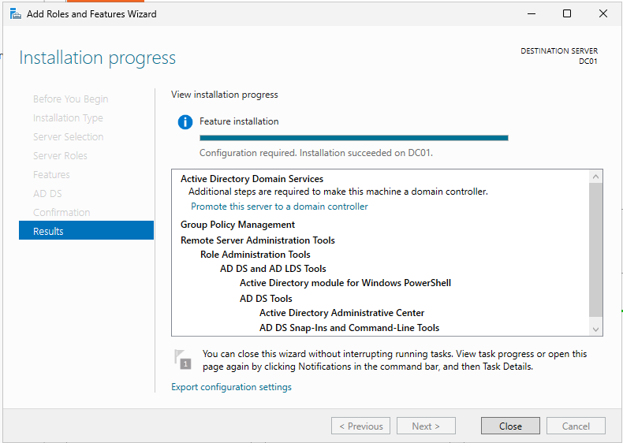
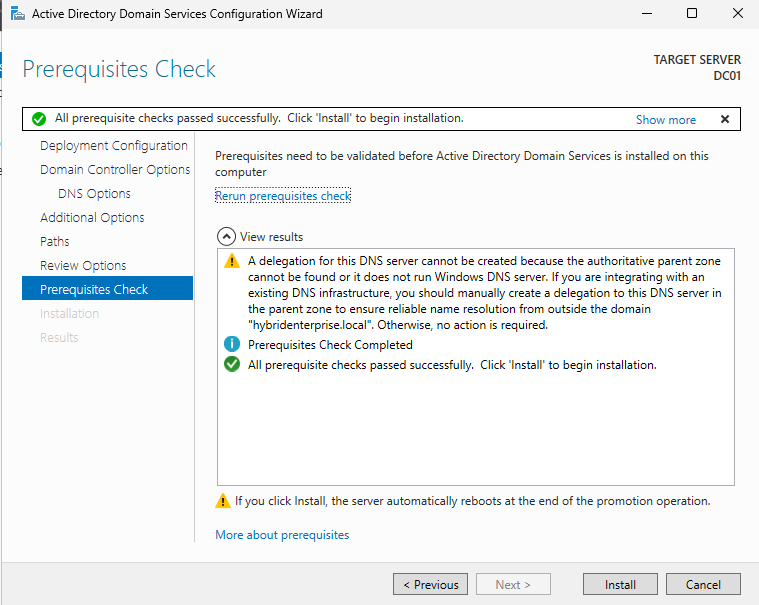
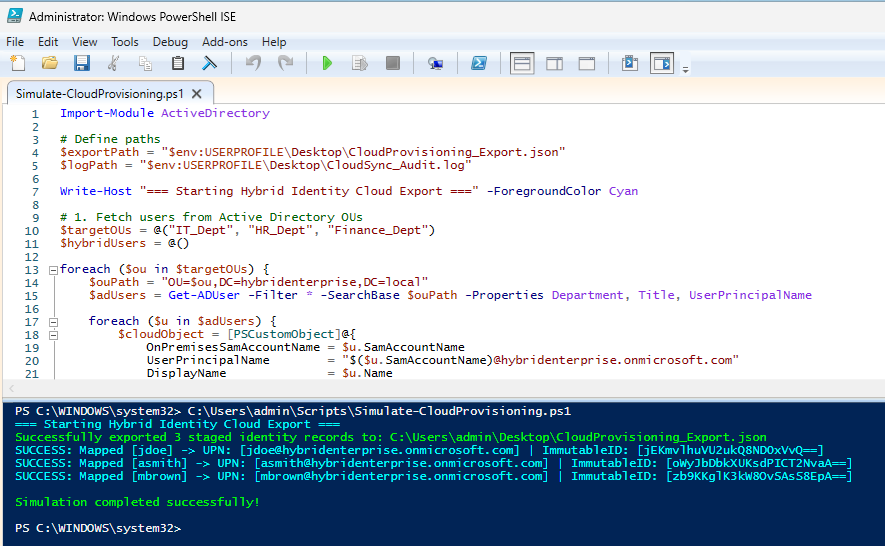
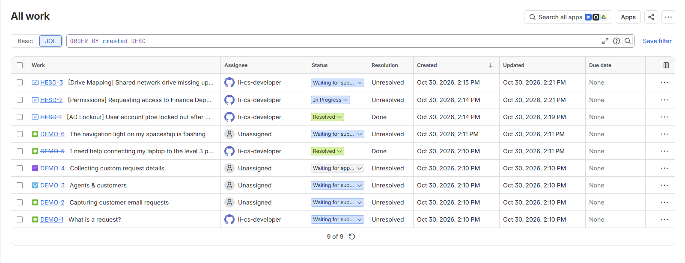
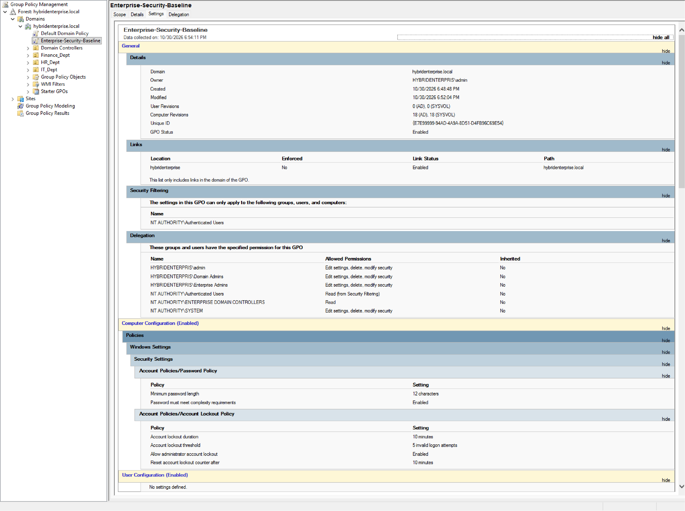
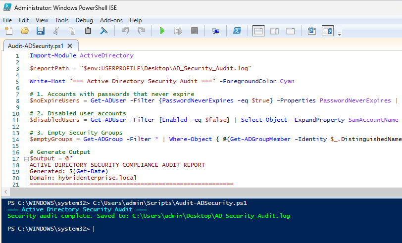

# Enterprise IT Infrastructure & Hybrid Identity Lab

A portfolio-grade enterprise IT infrastructure and identity management lab built using **VMware Workstation Pro**, **Windows Server 2025**, **PowerShell Automation**, and **Jira Service Management**. 

This repository demonstrates hands-on competencies in Systems Administration, Active Directory Domain Services (AD DS), automated user lifecycle management, staged cloud identity synchronization, local security hardening, and ITIL-aligned service desk escalation workflows.

---

## 🏗️ Architecture & Lab Specifications

* **Hypervisor:** VMware Workstation Pro
* **Domain Controller (`DC01`):** Windows Server 2025 (`hybridenterprise.local`)
* **Network Topology:** Isolated NAT Subnet (`192.168.10.0/24`) with custom DNS forwarders
* **Core Stack:** Active Directory Domain Services (AD DS), DNS, DHCP, Group Policy (GPMC), PowerShell 7+, Jira Service Management (Cloud)
* **Protocols & Administrative Concepts:** TCP/IP, Kerberos Authentication, Role-Based Access Control (RBAC), Principle of Least Privilege, NTFS & Share Permissions

---

## 📑 Project Implementation & Phases

### **Phase 1: Active Directory Infrastructure & Network Setup**
* Deployed and promoted `DC01` as the primary Domain Controller for `hybridenterprise.local`.
* Configured static network bindings, TCP/IP parameters, internal DNS routing, and subnets.
* Built departmental Organizational Units (OUs): `IT_Dept`, `HR_Dept`, and `Finance_Dept` applying Role-Based Access Control (RBAC) principles.

### **Phase 2: PowerShell User Automation & Hybrid Identity Staging**
* **Bulk User Onboarding (`Automated-ADOnboarding.ps1`):** Automated the parsing of `NewUsers.csv` to provision departmental accounts (`jdoe`, `asmith`, `mbrown`) in AD DS with forced initial password change flags following the Principle of Least Privilege.
* **Hybrid Identity Staging (`Simulate-CloudProvisioning.ps1`):** Developed an automated pipeline to extract local AD user attributes, map User Principal Names (UPNs) to `@hybridenterprise.onmicrosoft.com`, and generate Base64 `ImmutableID` anchor hashes to simulate Entra ID (Azure AD) sync schemas, outputting structured JSON and audit logs.

### **Phase 3: ITSM Help Desk & Incident Escalation Workflow**
* Integrated **Jira Service Management** (`Hybrid Enterprise Service Desk`) to model ITIL-aligned service desk workflows and SLA tracking.
* Managed support tickets tied directly to lab accounts (`jdoe`, `asmith`, `mbrown`):
  * **`HESD-1` (Resolved):** AD account lockout resolution, identity verification, and Kerberos ticket/password enforcement.
  * **`HESD-2` (In Progress):** Departmental share permissions, NTFS access control, and AD security group assignment.
  * **`HESD-3` (Waiting for support):** Network drive GPO mapping troubleshooting and logon script validation.

### **Phase 4: Security Hardening & Infrastructure Compliance Auditing**
* **Group Policy Enforcement (`Enterprise-Security-Baseline`):** Applied domain-wide GPOs for account lockout thresholds (5 invalid attempts) and password complexity policies (minimum length 12).
* **Automated Compliance Auditing (`Audit-ADSecurity.ps1`):** Scripted automated security scans targeting accounts with non-expiring passwords, disabled users, and unassigned security groups.

---

---

## 🖼️ Verification & Screenshots

### Phase 1: Active Directory Role Installation & DNS



### Phase 1: Domain Controller Promotion Verification



### Phase 2: Automated AD User Provisioning via PowerShell


### Phase 2: Hybrid Identity JSON Export & Base64 Hash Staging



### Phase 3: Jira Service Management Ticket Lifecycle & Queue



### Phase 4: Group Policy Security Baseline & Lockout Thresholds



### Phase 4: PowerShell AD Security Compliance Audit Report



---

## 📂 Repository Structure

```text
windows-server-ad-hybrid-identity/
│
├── README.md                          # Comprehensive portfolio documentation
├── logs/
│   ├── AD_Security_Audit.log          # Security compliance audit report
│   ├── CloudProvisioning_Export.json  # Staged cloud user export schema
│   ├── CloudSync_Audit.log            # Identity mapping execution log
│   └── NewUsers.csv                   # Source user onboarding dataset
├── screenshots/                       # Execution proof (01 - 07)
│   ├── 01-ad-ds-install.png
│   ├── 02-domain-promotion-check.png
│   ├── 03-ad-automated-users.png
│   ├── 04-hybrid-cloud-export.png
│   ├── 05-jira-itsm-workflow.png
│   ├── 06-gpo-security-baseline.png
│   └── 07-ad-security-audit.png
└── scripts/
    ├── Audit-ADSecurity.ps1           # AD security auditing script
    ├── Automated-ADOnboarding.ps1     # Bulk user provisioning script
    └── Simulate-CloudProvisioning.ps1 # Hybrid identity staging script

```

---

## 🛠️ Execution & Usage Instructions

1. Clone the repository to a domain-joined machine or Domain Controller:
```powershell
git clone [https://github.com/your-username/windows-server-ad-hybrid-identity.git](https://github.com/your-username/windows-server-ad-hybrid-identity.git)

```


2. Run the user provisioning script in an elevated PowerShell console:
```powershell
.\scripts\Automated-ADOnboarding.ps1

```


3. Run the hybrid identity cloud staging script:
```powershell
.\scripts\Simulate-CloudProvisioning.ps1

```


4. Run the security compliance report script:
```powershell
.\scripts\Audit-ADSecurity.ps1

```
